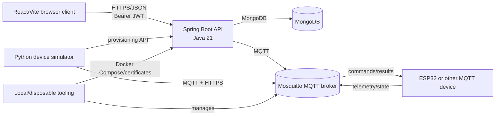

# NexaIoT — Smart IoT Device Monitoring and Control Platform

NexaIoT is a full-stack IoT platform for registering devices, describing their capabilities, receiving telemetry, sending MQTT commands, monitoring alerts, generating reports, and managing device enrollment. It contains a React/Vite web application, a Spring Boot backend, Python device tooling, an ESP32 reference firmware target, and local/integration test harnesses.

This README reflects the implementation currently present in the repository. It is a development project, not a completed V1.0.0 release.

## Table of contents

- [Overview](#overview)
- [Key features](#key-features)
- [Architecture](#architecture)
- [Technology stack](#technology-stack)
- [Project structure](#project-structure)
- [Device architecture](#device-architecture)
- [Templates and capabilities](#templates-and-capabilities)
- [Backend and frontend](#backend-and-frontend)
- [MQTT communication](#mqtt-communication)
- [Provisioning and security](#provisioning-and-security)
- [Python simulator](#python-simulator)
- [ESP32 firmware](#esp32-firmware)
- [Prerequisites and configuration](#prerequisites-and-configuration)
- [Running locally](#running-locally)
- [Testing](#testing)
- [Disposable integration testing](#disposable-integration-testing)
- [API overview](#api-overview)
- [Limitations and future work](#limitations-and-future-work)
- [Contributing](#contributing)
- [License](#license)

## Overview

The runtime consists of a React client and a Java backend. The backend stores users, devices, manifests, telemetry, alerts, tasks, reports, provisioning sessions, enrollment operations, firmware metadata, and password-reset data in MongoDB. It communicates with devices through MQTT; the browser communicates with the backend through authenticated HTTP APIs.

The repository also contains a Python MQTT simulator that can publish manifest-aware telemetry, process commands, and participate in secure enrollment. `firmware/esp32-smart-fan` is a PlatformIO/Arduino reference target for an ESP32 with a DHT22 and relay/LED.

## Key features

- Registration, login, JWT bearer authentication, password reset, profile/preferences, profile images, password changes, and account deletion.
- Owner-scoped device registration, updates, deletion, diagnostics, activity, and control.
- Built-in device templates and validated custom capability manifests.
- Capability-aware boolean, numeric, and enum controls.
- MQTT telemetry/state ingestion with topic and manifest validation.
- MQTT command IDs, correlation IDs, command results, and status polling.
- Alerts, alert rules, acknowledgement/read/resolve flows, and offline monitoring.
- Telemetry reports, energy analytics, and maintenance tasks.
- Administrator user/device/statistics views and firmware package metadata.
- Pairing sessions, enrollment operations, broker identity provisioning, trust-anchor registration, credential-delivery challenges, and enrollment recovery/reconciliation.
- Local HTTPS/MQTT development orchestration and an isolated disposable integration harness.

## Architecture



The browser does not connect directly to MQTT. It calls the backend, which publishes commands and consumes device messages.

## Technology stack

| Area | Implementation |
| --- | --- |
| Frontend | React 19, React Router, Vite, Tailwind CSS, Recharts, Lucide React, Lottie |
| Backend | Spring Boot 4.1.1, Java 21, Web MVC, Validation, Security, Mail, DevTools |
| Persistence | Spring Data MongoDB and MongoDB |
| Authentication | Spring Security and JWT (`jjwt` 0.12.6) |
| Messaging | Spring Integration MQTT, Eclipse Paho MQTT v3, Mosquitto-compatible brokers |
| Simulator | Python 3, `paho-mqtt`, `cryptography`, `pyserial` |
| Firmware | PlatformIO, Arduino, ESP32, ArduinoJson, PubSubClient, DHT sensor library |
| Local infrastructure | Docker Compose and OpenSSL-generated development certificates |

## Project structure

```text
NexaIoT/
├── client/                         React/Vite frontend
│   ├── src/api/                    HTTP API clients
│   ├── src/components/             Reusable UI/device components
│   ├── src/pages/                  Public, auth, app, and admin pages
│   ├── src/config/                 Capability/status/preferences config
│   └── tests/                      Frontend tests
├── server/                         Spring Boot backend
│   ├── src/main/java/              Controllers, services, MQTT, security
│   ├── src/main/resources/          Properties and device templates
│   └── src/test/java/              Java tests
├── simulator/                      Python MQTT/enrollment simulator
├── firmware/esp32-smart-fan/       PlatformIO ESP32 target
├── tools/local-development/        Local MongoDB/Mosquitto/HTTPS orchestration
├── tools/disposable-integration/   Isolated disposable integration harness
├── tools/mqtt-backend-provisioning/ Broker identity helpers
├── tools/mqtt-dynsec-test/         Dynamic Security configuration
├── tools/arduino-serial-bridge/    Serial bridge and tests
├── docs/                            MQTT and HTTP security notes
└── README.MD
```

## Device architecture

### Built-in templates

Templates are JSON resources in `server/src/main/resources/device-templates` and are served by `/api/device-templates`. Registering with a `templateId` copies the template's capability manifest into the device record.

### Custom manifests

Registration can instead supply a custom capability manifest. The backend validates manifest version, keys, categories, data types, controls, options, and constraints. A request must choose either `templateId` or `capabilityManifest`, not both. Manifest categories include `MEASUREMENT`, `STATE`, `DEVICE_METRIC`, and `CONTROL`; data types include `NUMBER`, `BOOLEAN`, `STRING`, and `ENUM`.

### Auto-discovered devices

The domain model includes a `DISCOVERED` manifest source, but the repository does not contain a general-purpose network discovery service or automatic broker-discovery workflow. Devices currently enter through registration/provisioning APIs or the UI.

## Templates and capabilities

| Template ID | Name | Declared capabilities |
| --- | --- | --- |
| `dc-motor-controller` | DC Motor Controller | `motorSpeed`, `power`, `targetSpeed`, `direction` |
| `energy-meter` | Energy Meter | `voltage`, `current`, `power`, `energyConsumption` |
| `smart-fan` | Smart Fan | `temperature`, `power` |
| `smart-switch` | Smart Switch | `power` |
| `soil-moisture-sensor` | Soil Moisture Sensor | `soilMoisture`, `battery`, `rssi` |
| `temperature-humidity-sensor` | Temperature & Humidity Sensor | `temperature`, `humidity` |
| `temperature-sensor` | Temperature Sensor | `temperature` |
| `weather-station` | Weather Station | `temperature`, `humidity`, `rainfall`, `windSpeed` |

## Backend and frontend

The backend is divided into authentication/security, devices/templates, sensor/energy analytics, alerts, reports, tasks, MQTT, provisioning/enrollment, administration, firmware metadata, and simulator contracts. It starts on port `8081` by default. The local-development scripts additionally configure HTTPS on port `8443`.

The frontend uses React Router with public pages, authentication pages, protected app pages, and admin-only `/admin` and `/admin/firmware` routes. `client/src/api/client.js` reads `VITE_API_URL` and sends the JWT from browser storage as a bearer token. Its default API URL is `http://localhost:8081`.

## MQTT communication

The default broker URL is `tcp://localhost:1883`. TLS uses an `ssl://` URL, CA certificate, and `MQTT_TLS_REQUIRED=true`.

For `<deviceKey>`, the topic shapes are:

| Purpose | Topic |
| --- | --- |
| Telemetry | `nexaiot/devices/<deviceKey>/telemetry` |
| State | `nexaiot/devices/<deviceKey>/state` |
| Commands | `nexaiot/devices/<deviceKey>/commands` |
| Command results | `nexaiot/devices/<deviceKey>/command-results` |
| Activation challenges | `nexaiot/devices/<deviceKey>/activation-challenges` |
| Activation responses | `nexaiot/devices/<deviceKey>/activation-responses` |

Telemetry contains a `metrics` object and may include `battery`, `rssi`, and an ISO-8601 `timestamp`. Metrics must be declared by the effective manifest and be valid numeric values where applicable. Legacy power commands are `{"power":true}`/`{"power":false}`; capability-aware commands contain `capabilityKey` and `value`. The backend returns command and correlation IDs and consumes command results.

## Provisioning and security

The enrollment flow is explicit and owner-authorized:

1. Start a device pairing session.
2. Claim it with a fresh pairing token and hardware identity hash.
3. Start an enrollment operation and verify broker-side identity/provisioning state.
4. Complete a trust-anchor challenge using the device key/fingerprint.
5. Use credential-delivery challenge/response contracts.
6. Verify activation; recovery and reconciliation handle interrupted operations.

Pairing expiry, claim attempts, challenge lifetimes, credential escrow, broker management, and TLS requirements are configurable. The broker must enforce per-device ACLs because an ordinary inbound MQTT message cannot prove its original publisher identity. See [`docs/MQTT_SECURITY.md`](docs/MQTT_SECURITY.md) and [`docs/HTTP_SECURITY.md`](docs/HTTP_SECURITY.md).

## Python simulator

Install the simulator dependencies and run a basic device:

```powershell
cd simulator
python -m venv .venv
.\.venv\Scripts\Activate.ps1
python -m pip install -r requirements.txt
$env:NEXAIOT_DEVICE_KEY = "demo-device"
$env:MQTT_BROKER_URL = "tcp://localhost:1883"
$env:NEXAIOT_TELEMETRY_INTERVAL = "5"
python .\device_simulator.py
```

Set `NEXAIOT_MANIFEST` for a custom manifest. For TLS, use `ssl://`, set `MQTT_TLS_REQUIRED=true`, and set `MQTT_CA_CERTIFICATE`. Matching `MQTT_USERNAME` and `MQTT_PASSWORD` can be supplied. `onboard_device.py` provides the HTTPS/MQTT secure enrollment flow and requires an active pairing session and CA certificate.

## ESP32 firmware

`firmware/esp32-smart-fan` targets `esp32dev` with the Arduino framework. DHT22 data uses GPIO 4, relay/LED output uses GPIO 25, and the serial monitor uses 115200 baud.

```powershell
cd firmware\esp32-smart-fan
Copy-Item include\device_config.h.example include\device_config.h
# Edit device_config.h with isolated Wi-Fi, MQTT TLS, CA, and device values.
pio run
pio run -t upload
pio device monitor
```

The firmware publishes temperature telemetry and power state, accepts legacy and structured power commands, and publishes command results. It expects broker credentials in the local ignored header and does not itself implement the complete HTTP pairing/credential-delivery workflow.

## Prerequisites and configuration

Install Git, Java 21, Node.js/npm, Python 3 with `venv`/pip, Docker Desktop with Compose, MongoDB and an MQTT broker for direct runs, OpenSSL and `keytool` for the local HTTPS script, and PlatformIO for firmware work. Dependency versions are declared in `server/pom.xml`, `client/package.json`, and `simulator/requirements.txt`.

The main backend environment variables are:

| Variable | Purpose | Default/requirement |
| --- | --- | --- |
| `MONGODB_URI` | MongoDB connection string | Required by default configuration |
| `JWT_SECRET` | JWT signing secret | Required; use a strong private value |
| `JWT_EXPIRATION_MS` | JWT lifetime | `86400000` |
| `CORS_ALLOWED_ORIGINS` | Comma-separated browser origins | `http://localhost:5173` |
| `MQTT_BROKER_URL` | Application broker | `tcp://localhost:1883` |
| `MQTT_CLIENT_ID` | Backend MQTT client ID | `nexaiot-server` |
| `MQTT_USERNAME` / `MQTT_PASSWORD` | Broker credentials | Empty by default |
| `MQTT_AUTH_REQUIRED` / `MQTT_TLS_REQUIRED` | Broker policy flags | `false` / `false` |
| `MQTT_CA_CERTIFICATE` | MQTT CA path | Empty by default |
| `MQTT_QOS` | MQTT QoS | `1` |
| `MQTT_MANAGEMENT_ENABLED` | Broker management integration | `false` |
| `MQTT_MANAGEMENT_BROKER_URL` | Management broker | `tcp://127.0.0.1:1884` |
| `NEXAIOT_CREDENTIAL_ESCROW_KEY` | Credential escrow encryption key | Configure for provisioning |
| `NEXAIOT_CREDENTIAL_ESCROW_KEY_VERSION` | Escrow key version | Empty by default |
| `PAIRING_SESSION_EXPIRY_SECONDS` | Pairing lifetime | `600` |
| `PAIRING_SESSION_MAX_ATTEMPTS` | Claim attempt limit | `5` |
| `FRONTEND_URL` | Password-reset link base URL | `http://localhost:5173` |
| `MAIL_HOST`, `MAIL_PORT`, `MAIL_USERNAME`, `MAIL_PASSWORD`, `MAIL_FROM` | Password-reset email | Local SMTP defaults |

The complete mapping, including rate limits, challenge lifetimes, admin bootstrap, and MQTT topic settings, is in `server/src/main/resources/application.properties`. `VITE_API_URL` configures the frontend API URL. Never commit secrets, certificates, keystores, escrow keys, or private keys.

## Running locally

### Repository-managed local environment

Build the backend JAR, then use the Windows PowerShell orchestration script:

```powershell
cd server
.\mvnw.cmd -DskipTests package
cd ..
.\tools\local-development\Run-LocalDevelopment.ps1 -Action Start -Initialize
```

This starts Docker-managed MongoDB and Mosquitto, generates development certificates, starts Spring Boot, and prints the backend, MQTT, and CA paths. Lifecycle commands are:

```powershell
.\tools\local-development\Run-LocalDevelopment.ps1 -Action Status
.\tools\local-development\Run-LocalDevelopment.ps1 -Action RestartBackend
.\tools\local-development\Run-LocalDevelopment.ps1 -Action Stop
.\tools\local-development\Run-LocalDevelopment.ps1 -Action Clean
```

For the complete local preview:

```powershell
.\tools\local-development\Run-LocalDemo.ps1 -Action Start
.\tools\local-development\Run-LocalDemo.ps1 -Action Verify
```

The preview is `http://127.0.0.1:4173`, backend is `https://127.0.0.1:8443`, and MQTT TLS is `ssl://127.0.0.1:8885`.

### Direct component run

Start MongoDB and an MQTT broker, then configure and run the backend:

```powershell
cd server
$env:MONGODB_URI = "mongodb://127.0.0.1:27017/nexaiot"
$env:JWT_SECRET = "replace-with-a-local-development-secret"
$env:MQTT_BROKER_URL = "tcp://127.0.0.1:1883"
.\mvnw.cmd spring-boot:run
```

In another terminal:

```powershell
cd client
npm install
$env:VITE_API_URL = "http://127.0.0.1:8081"
npm run dev
```

## Testing

```powershell
# Backend tests
cd server
.\mvnw.cmd test

# Frontend tests, lint, and build
cd ..\client
npm test
npm run lint
npm run build

# Python simulator tests
cd ..
python -m unittest discover -s simulator -p "test_*.py"
```

Some Java tests and integration harnesses require MongoDB, Docker, Mosquitto, certificates, or configured environment services. This README does not claim that the full suite passes without those dependencies.

## Disposable integration testing

`tools/disposable-integration/Run-DisposableIntegration.ps1` creates an isolated, randomly named Docker Compose project with temporary ports, volumes, certificates, broker identities, and secrets. It verifies broker bootstrap/access, application health, administrator authorization, and enrollment lifecycle.

Run the non-mutating static check:

```powershell
.\tools\disposable-integration\Run-DisposableIntegration.ps1
```

Run live checks when Docker Desktop and the cached `eclipse-mosquitto:2` image with Dynamic Security are available:

```powershell
.\tools\disposable-integration\Run-DisposableIntegration.ps1 -RunLive
```

The default is host application mode; `-ApplicationMode Container` and `-KeepResources` are also supported. The harness cleans up its temporary resources unless instructed otherwise.

## API overview

The following paths are verified from the Spring controllers. Protected routes require a JWT bearer token unless noted. DTO request/response details are in `server/src/main/java`.

### Authentication and user

- `GET /api/health`
- `POST /api/auth/register`, `/api/auth/login`, `/api/auth/forgot-password`, `/api/auth/reset-password`
- `GET|PUT /api/user/me`, `PUT /api/user/me/preferences`, `POST /api/user/me/change-password`
- `POST|GET|DELETE /api/user/me/profile-image`, `DELETE /api/user/me`

### Devices and data

- `POST|GET /api/devices`, `GET|PUT|DELETE /api/devices/{id}`
- `POST /api/devices/{id}/control`, `GET /api/devices/{id}/diagnostics`, `GET /api/devices/{id}/activity`
- `GET /api/devices/{id}/commands/{commandId}`
- `GET /api/device-templates`, `GET /api/device-templates/{templateId}`
- `POST /api/devices/{deviceId}/readings`, `GET /api/devices/{deviceId}/readings`, `GET /api/devices/{deviceId}/readings/latest`
- `GET /api/devices/{deviceId}/energy`

### Alerts, rules, tasks, and reports

- Alerts: `GET /api/alerts`, `GET /api/alerts/{id}`, acknowledgement/resolve/read patches, and alert deletes.
- Rules: `GET|POST /api/alert-rules`, `GET|PUT|DELETE /api/alert-rules/{id}`.
- Tasks: `GET|POST /api/tasks`, `GET|PUT|DELETE /api/tasks/{id}`.
- Reports: `GET|POST /api/reports`, `GET|DELETE /api/reports/{id}`.

### Provisioning, administration, and firmware

- Pairing: `/api/devices/{deviceId}/pairing-sessions` and `/api/provisioning/pairing-sessions/{sessionId}/claim`.
- Enrollment: `/api/devices/{deviceId}/enrollment-operations/{operationId}` and its status, reconcile, trust-anchor, credential-delivery, and activation challenge routes.
- Admin: `GET /api/admin/users`, `GET /api/admin/devices`, `GET /api/admin/stats`, plus admin user/device deletes.
- Firmware: `GET|POST /api/admin/firmware`; upload uses multipart form data.

## Limitations and future work

Current limitations include:

- The ESP32 firmware expects credentials in a local header and does not perform the complete HTTP pairing/credential-delivery workflow.
- General-purpose automatic device discovery is not implemented end to end.
- Command status and rate limiting are in-memory and local to a backend process.
- Direct development needs separately managed MongoDB and MQTT unless the repository scripts are used.
- Password-reset delivery needs a configured SMTP service.
- Live integration results depend on local Docker images, services, certificates, and configuration.

Potential future work includes completing device-side onboarding, adding shared stores for rate limits and command status, implementing first-class discovery, adding deployment/observability assets, and expanding hardware-in-the-loop testing.

## Contributing

1. Create a focused branch from the current development line.
2. Keep secrets and generated runtime files out of commits.
3. Update source-level tests when changing behavior.
4. Run the relevant backend, frontend, simulator, and integration checks.
5. Keep documentation aligned with the actual source and configuration.

## License

No license file or license declaration is currently present. Treat the project as unlicensed unless the repository owner adds an explicit license.
